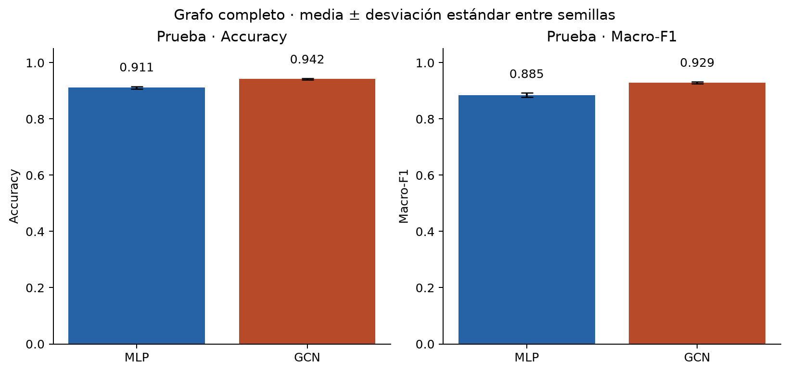
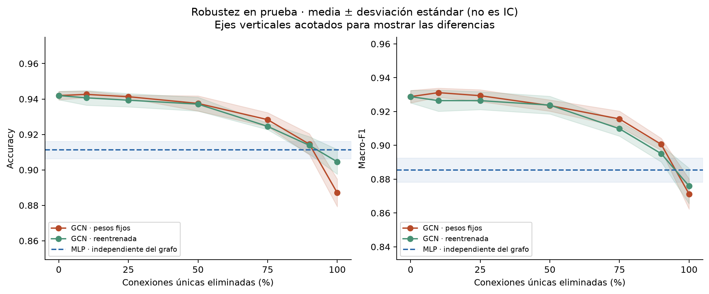
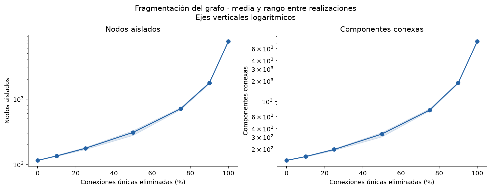
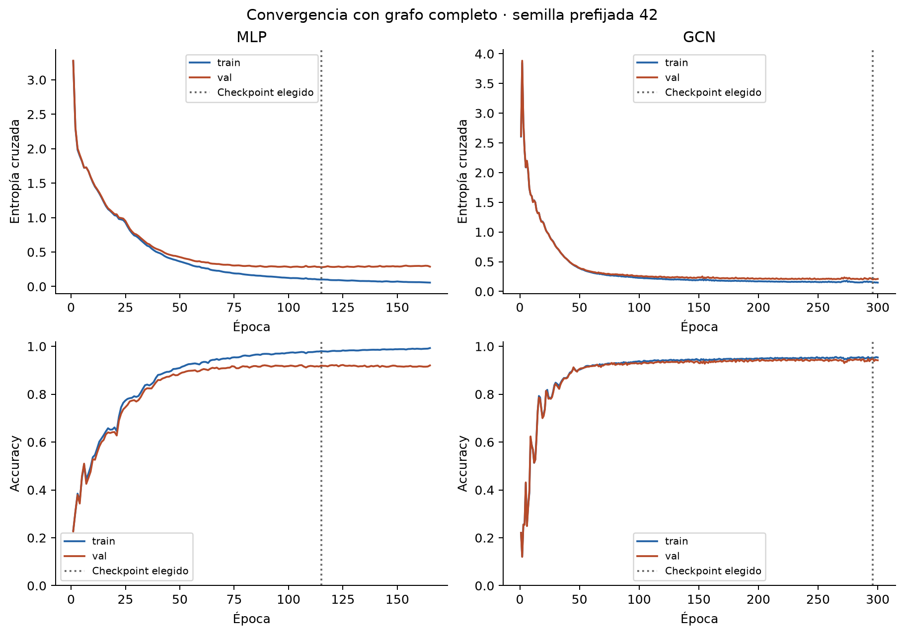
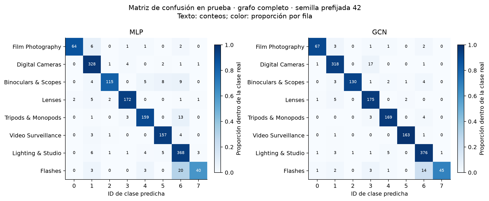

# Etapa 3: comparación MLP/GCN y robustez de Amazon Photo

Ejecución real del **16 de noviembre de 2026**. Semillas 42–46, partición fija con semilla 42. Este informe corresponde a la configuración de [`manifest.json`](manifest.json); no se regenera automáticamente si se cambia el CLI.

## Preguntas y protocolo

1. ¿Mejora la clasificación al usar la red de compras conjuntas, frente a una MLP que sólo usa atributos?
2. ¿Qué ocurre cuando faltan progresivamente conexiones?
3. ¿Cambia la respuesta si se permite reentrenar sobre el grafo incompleto?

Amazon Photo contiene 7.650 productos, 745 atributos y ocho categorías. Sus 238.162 entradas de `edge_index` representan 119.081 conexiones únicas no dirigidas. Se mantienen las máscaras originales: 4.590 nodos de entrenamiento, 1.530 de validación y 1.530 de prueba. Es un problema transductivo: las características de todos los nodos y las conexiones disponibles se conocen al entrenar; las etiquetas ajenas a train no contribuyen al gradiente.

Se conservan las arquitecturas de la segunda etapa: dos capas, dimensión oculta 64, ReLU y dropout 0,5, **48.264 parámetros** por modelo. Adam usa learning rate 0,01 y weight decay 0,0005. La pérdida es entropía cruzada sólo en train. Se restaura el checkpoint de menor pérdida de validación, con un máximo de 300 épocas y paciencia 50. No hay búsqueda de hiperparámetros ni selección de semillas según test.

La eliminación es uniforme, sin reemplazo y sin consultar etiquetas. Por semilla, una permutación de pares únicos define conjuntos anidados al 0%, 10%, 25%, 50%, 75%, 90% y 100%; se retiran los dos sentidos de cada par. La semilla de aristas es `semilla_entrenamiento + 10000`. El número eliminado es `floor(fracción × 119081)`, por lo que puede haber una diferencia de redondeo respecto del porcentaje nominal. Todos los nodos y características permanecen.

- **Pesos fijos (`inference`):** GCN entrenada una vez con el grafo completo y evaluada con cada grafo reducido.
- **Reentrenamiento (`retrain`):** GCN reinicializada en cada condición, usando la misma semilla de inicialización y su propia selección por validación.
- **MLP (`attributes`):** entrenada una vez por semilla, porque ignora `edge_index`. Su resultado constituye una referencia constante ante la eliminación.

Hay **40 entrenamientos**: cinco MLP y 35 GCN. Los dos protocolos comparten el checkpoint GCN al 0%, y las evaluaciones con pesos fijos no agregan entrenamientos. Las 75 filas de métricas incluyen esas evaluaciones compartidas, por lo que no son 75 entrenamientos independientes.

## Comparación con el grafo completo

Accuracy y macro-F1 están expresados en **porcentaje**, como **media ± desviación estándar muestral entre cinco semillas**. La desviación no es un intervalo de confianza. El macro-F1 da el mismo peso a cada categoría.

| Modelo | Accuracy de prueba (%) | Macro-F1 de prueba (%) |
|---|---:|---:|
| MLP | 91.12 ± 0.48 | 88.54 ± 0.71 |
| GCN | 94.20 ± 0.24 | 92.88 ± 0.37 |

La diferencia GCN menos MLP, emparejada por semilla, es **+3.07 ± 0.31 puntos porcentuales en accuracy** y **+4.34 ± 0.60 puntos en macro-F1**. La GCN supera a la MLP en accuracy en 5 de las cinco semillas. Es una comparación descriptiva en esta partición, sin prueba de significancia ni afirmación de superioridad universal.



## Efecto de eliminar conexiones

| Eliminación | Accuracy pesos fijos (%) | Macro-F1 pesos fijos (%) | Accuracy reentrenada (%) | Macro-F1 reentrenada (%) |
|---|---:|---:|---:|---:|
| 0% | 94.20 ± 0.24 | 92.88 ± 0.37 | 94.20 ± 0.24 | 92.88 ± 0.37 |
| 10% | 94.26 ± 0.19 | 93.12 ± 0.27 | 94.07 ± 0.41 | 92.64 ± 0.63 |
| 25% | 94.13 ± 0.09 | 92.94 ± 0.35 | 93.93 ± 0.38 | 92.64 ± 0.53 |
| 50% | 93.75 ± 0.43 | 92.35 ± 0.33 | 93.71 ± 0.39 | 92.38 ± 0.52 |
| 75% | 92.84 ± 0.40 | 91.56 ± 0.46 | 92.46 ± 0.18 | 90.98 ± 0.44 |
| 90% | 91.45 ± 0.59 | 90.06 ± 0.36 | 91.39 ± 0.49 | 89.51 ± 0.49 |
| 100% | 88.71 ± 0.78 | 87.12 ± 0.89 | 90.46 ± 0.70 | 87.60 ± 1.05 |

La referencia MLP permanece en **91.12 ± 0.48% de accuracy** y **88.54 ± 0.71% de macro-F1** para todos los niveles; no se reentrena repetidamente para producir la línea horizontal.



Al eliminar el 90% de las conexiones, la GCN con pesos fijos obtiene 91.45% de accuracy, próxima al 91.12% de la MLP. Al eliminar todas, pasa de 94.20% a 88.71%: un cambio de -5.49 puntos porcentuales respecto del grafo completo. Con reentrenamiento y sin conexiones entre productos alcanza 90.46%.

No se observa una mejora sistemática al reentrenar en los niveles intermedios: con esta configuración, sus medias son similares o algo menores que con pesos fijos. Al 100%, reentrenar recupera 1.75 puntos de accuracy frente a mantener los pesos del grafo completo. Son resultados de este protocolo con hiperparámetros fijos; no se puede asumir que reentrenar siempre mejore.

Al 100%, la GCN conserva únicamente los autoenlaces que introduce `GCNConv`. Con los mismos pesos, esa arquitectura se reduce al procesamiento por nodo de una MLP de dos capas; se comprobó esa equivalencia en una prueba automatizada. Los modelos entrenados por separado pueden dar resultados distintos por su inicialización y trayectoria de optimización. Por ello, la diferencia entre las curvas de pesos fijos y reentrenamiento debe interpretarse como sensibilidad al cambio de grafo frente a capacidad de adaptación, sin asumir que ambos protocolos responden la misma pregunta.

No se debe imponer monotonía a las métricas: retirar más conexiones puede producir fluctuaciones locales. Por ejemplo, eliminar el 10% con pesos fijos cambia la accuracy media en apenas +0.07 puntos respecto del grafo completo, sin que eso permita recomendar ese nivel como óptimo. El muestreo es uniforme; estos resultados no describen un ataque dirigido ni pérdidas concentradas en una categoría. Los ejes verticales de la figura de robustez están acotados y etiquetados para hacer visibles las diferencias.

## Fragmentación y convergencia

Las siguientes cantidades son medias de las cinco realizaciones del grafo; las conexiones retenidas tienen el mismo conteo en todas ellas.

| Eliminación | Conexiones únicas retenidas | Aislados (media) | Componentes (media) | Componente mayor (media) |
|---|---:|---:|---:|---:|
| 0% | 119,081 | 115.0 | 136.0 | 7487.0 |
| 10% | 107,173 | 134.8 | 155.0 | 7468.0 |
| 25% | 89,311 | 176.2 | 197.0 | 7426.8 |
| 50% | 59,541 | 308.6 | 332.4 | 7287.0 |
| 75% | 29,771 | 711.4 | 747.0 | 6860.0 |
| 90% | 11,909 | 1762.6 | 1877.6 | 5496.2 |
| 100% | 0 | 7650.0 | 7650.0 | 1.0 |



La figura usa ejes verticales logarítmicos. Al 90% de eliminación ya hay una media de 1,762.6 nodos aislados y la componente mayor tiene 5,496.2 nodos. El resultado residual alto es compatible con que las características por sí solas ya permiten a la MLP alcanzar 91.12% de accuracy; la conectividad aporta una mejora adicional con el grafo completo.

Las curvas de aprendizaje muestran train y validación, nunca test por época. Las matrices de confusión usan la semilla **42**, prefijada como ejemplo; no se seleccionó la mejor semilla de prueba. En las matrices, el texto son conteos y el color está normalizado por clase real.





**21 de los 40 entrenamientos alcanzaron el límite de 300 épocas.** No se garantiza convergencia completa ni rendimiento óptimo con este presupuesto. La configuración no se cambió a partir de los resultados de prueba.

## Verificación y reproducibilidad

La ejecución principal tardó aproximadamente **7.7 minutos** en CPU con un hilo, en el entorno registrado en el manifiesto. El tiempo depende del equipo y de la carga concurrente.

- **18 pruebas automatizadas superadas** y `pip check` sin incompatibilidades.
- Recarga de **40 checkpoints** con `weights_only=True`; las **75 condiciones** de métricas se recalcularon y coincidieron con el CSV guardado.
- Verificación de los **35 grafos**: reciprocidad, ausencia de lazos, conteos, huellas y conjuntos anidados.
- Cada checkpoint coincide con la primera época de menor pérdida de validación en su historial. Se comprobaron las medias y desviaciones de las 15 filas del resumen.
- Dos procesos independientes produjeron exactamente las mismas historias, pesos seleccionados y métricas finales de la semilla 42 sobre el grafo completo.
- Los tensores, archivos originales y máscaras permanecieron intactos, y sus huellas coinciden con las registradas en la primera etapa.

Detalle de la auditoría: [`verification.json`](verification.json). Datos primarios: [`metrics.csv`](metrics.csv), [`summary.csv`](summary.csv), [`paired_differences.csv`](paired_differences.csv), [`graphs.csv`](graphs.csv), [`histories/`](histories/) y [`confusion_matrices.csv`](confusion_matrices.csv).

Para reproducir desde la raíz:

```bash
source .venv/bin/activate
python -m amazon_photo.experiment
python -m unittest discover -s tests -v
```

Las máscaras deben existir previamente (`python -m amazon_photo.prepare --seed 42`). Los checkpoints se generan en `artifacts/experiments/`, excluido de Git. El dataset y el entorno virtual también están excluidos; se mantienen los CSV, informes y figuras. Ver configuración y carga de checkpoints en el [README](../../README.md).

## Alcance de las conclusiones

El estudio compara el aporte de compras conjuntas y distingue la pérdida de información durante evaluación de su ausencia desde entrenamiento. Sus conclusiones se limitan a **Amazon Photo, esta partición y eliminación uniforme**. Las semillas combinan variabilidad de inicialización y de muestreo; no permiten aislar ambas fuentes por separado ni estimar incertidumbre entre particiones. No hay una búsqueda simétrica de hiperparámetros para estimar el mejor rendimiento posible de cada arquitectura. Tampoco se estudian ataques, grafos dirigidos, cambios en las características o etiquetas, ni otros datasets.

Se utilizó el entorno existente con Python 3.14.7; no se probó instalar desde cero. Persisten avisos de compatibilidad de PyTorch/PyG con Python 3.14, aunque entrenamiento y auditoría terminaron correctamente. No se garantiza reproducibilidad bit a bit entre plataformas o versiones.
